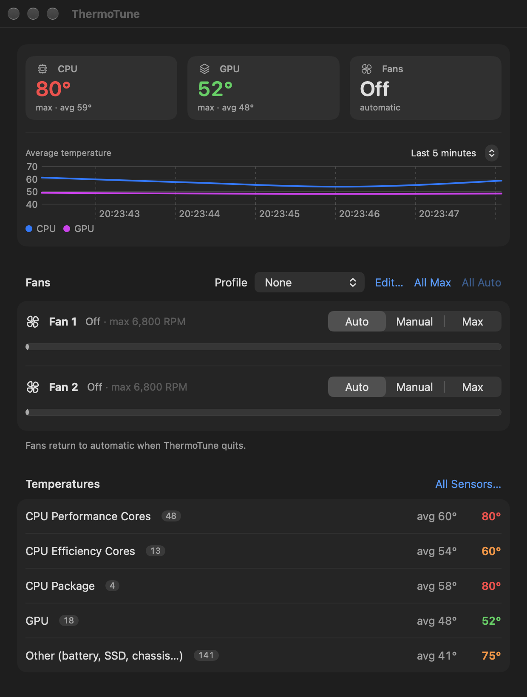

# ThermoTune

[](https://github.com/armendu/ThermoTune/actions/workflows/ci.yml)
[](LICENSE)


See your Mac's CPU and GPU temperatures, and take control of its fans. ThermoTune is a native
SwiftUI app that reads the System Management Controller (SMC) directly: no kernel extensions,
no background daemons, no third-party code.

<p align="center">
  
</p>

> [!WARNING]
> ThermoTune changes how your Mac cools itself. Manual fan speeds stay where you put them
> however hot the Mac gets, until you switch back to Automatic or quit the app. It's built and
> tested on an M3 Pro MacBook Pro; other Macs should work but haven't been confirmed. Use it at
> your own risk.

## Features

- **Temperatures:** finds every temperature sensor your Mac has. Shows the hottest and average
  reading for the CPU (performance and efficiency cores separately on Apple silicon) and the
  GPU, plus a chart of the average CPU and GPU temperature over the last 1 to 60 minutes. Hover over a group's temperatures to see every sensor behind
  them, or open **All Sensors…** for the full list.
- **Fan control:** see each fan's current and maximum speed, and set it to **Auto** (macOS
  decides), **Manual** (pick a speed with a slider) or **Max**. **All Max** and **All Auto**
  switch every fan at once.
- **Profiles:** reusable fan behaviours for every fan:
  - *System Automatic*: macOS manages the fans.
  - *Fixed Speed*: a set share of each fan's speed range.
  - *Temperature Curve*: fans ramp up from minimum to full speed between two temperatures of
    the CPU, the GPU, or whichever is hotter.
  - *Full Speed*: every fan at maximum.

  ThermoTune comes with **Automatic**, **Balanced**, **Cool** and **Full Speed**, and you can
  create your own.
- **Menu bar:** a live temperature in the menu bar, with a quick panel for profiles and fan
  actions. ThermoTune keeps running there after you close its window.
- **Preferences (⌘,):** launch at login, °C or °F, refresh rate, which temperature the menu bar
  shows, and what happens to the fans when you quit. The About tab has the version, license
  and links to the source.

## Requirements

- macOS 15 or newer
- A Mac with fans. Apple silicon is tested; Intel is supported in the code but untested.
- Xcode 16 or newer, to build it

## Install

There are no prebuilt downloads yet; build it from source:

```sh
git clone https://github.com/armendu/ThermoTune.git
cd ThermoTune
make release
open build/Build/Products/Release/ThermoTune.app
```

Copy `ThermoTune.app` into `/Applications` if you want to keep it. Temperatures work straight
away. To change fan speeds, click **Install Helper…** under the fans. macOS asks for your
administrator password once, for the reason explained below.

## How it works

Any app can *read* the SMC, but only root can *write* to it. ThermoTune therefore installs a
small helper tool at `/Library/PrivilegedHelperTools/com.armend.ThermoTune.Helper`, owned by
root with the setuid bit set, so changing fans doesn't ask for a password every time. The helper
accepts only these commands, and only ever writes fan settings:

```
status              show every fan's speed, range and mode
set <fan> <rpm>     manual speed for one fan, clamped to that fan's own range
max-all             every fan at full speed
auto <fan>          hand one fan back to macOS
auto-all            hand every fan back to macOS
```

**The first switch to Manual or Max takes a few seconds.** On Apple silicon, ThermoTune first
has to ask the SMC to release fan control, and the SMC takes about 5 to 10 seconds to agree.
Later changes are instant. While any fan is under manual control, macOS's own fan management is
paused for every fan, so ThermoTune shows all of them as manual until the last one goes back to
Auto.

**Your fans are handed back when ThermoTune quits.** That includes being quit from the terminal
with `kill`. You can turn this off in Preferences if you want a profile to keep running without
the app; it's re-applied the next time ThermoTune starts. If a crash ever leaves a fan in manual
mode, run:

```sh
/Library/PrivilegedHelperTools/com.armend.ThermoTune.Helper auto-all
```

## Uninstall

1. In ThermoTune, open **Preferences › Helper** and click **Uninstall Helper…**. This also hands
   the fans back to macOS.
2. Quit ThermoTune and delete the app.

## Contributing

Bug reports, Mac-model confirmations and pull requests are welcome. Start with
[CONTRIBUTING.md](CONTRIBUTING.md). Report security issues privately, as described in
[SECURITY.md](SECURITY.md).

## License

[MIT](LICENSE) © Armend Ukëhaxhaj
